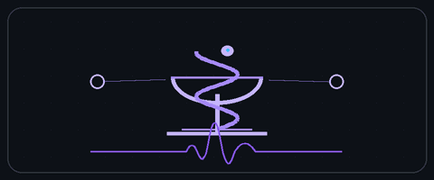
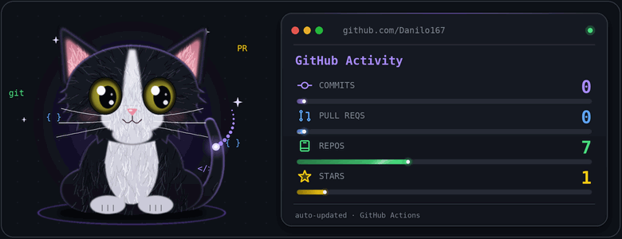

  

<h1 align="center">
  
</h1>

Olá! Me chamo **Danilo Scheidt Caxias do Rêgo**, tenho 23 anos, sou natural de Rio Tinto (PB) e tenho uma trajetória interdisciplinar focada na convergência entre **Tecnologia da Informação** e **Ciências da Saúde (HealthTech)**.

Graduando em Sistemas de Informação pela Universidade Federal da Paraíba (UFPB) e em fase de conclusão do bacharelado em Farmácia pela Cruzeiro do Sul Virtual, busco sempre aprender, desenvolver novas habilidades e explorar diferentes áreas do conhecimento.

 

  
<h2 align="center">
◈ Academic Profile ◈
</h2>

`TECNOLOGIA` &nbsp;·&nbsp; `PROGRAMAÇÃO` &nbsp;·&nbsp; `CIÊNCIA` &nbsp;·&nbsp; `SAÚDE`

> ### `01 Formação Acadêmica`
>
> **Bacharelado em Sistemas de Informação**  
> Universidade Federal da Paraíba (UFPB)
>
> **Bacharelado em Farmácia**  
> Cruzeiro do Sul Virtual

> ### `02 Formação Técnica`
>
> **Técnico em Administração**  
> Mediotec
>
> **Técnico em Agronegócio**  
> ECIT MME

 

  <samp>Academic Profile · 2026</samp>

<b><samp>「 𝐒𝐚𝐛𝐞𝐫 𝐌𝐚𝐢𝐬 」</samp></b>

<h3>Tech Stack</h3>

  

<h3>Featured Projects</h3>

  

### Kanban Web
> *Sistema Web de Gestão Visual de Fluxos de Trabalho*

  
  &nbsp;
  
  &nbsp;
  
  &nbsp;
  
  &nbsp;
  

* **Descrição:** Sistema web para organização e gerenciamento de demandas operacionais baseado no método Kanban, estruturando tarefas nas etapas Começar, Fazendo e Concluído para maior clareza e produtividade.
* **Minha Atuação:** Construção e implementação da interface do usuário, modelagem de processos, prototipagem navegável e estruturação da documentação de requisitos funcionais e backlog do projeto.
* **Stack Tecnológica:** `HTML5` &bull; `CSS3` &bull; `Notion` &bull; `Figma` &bull; `Draw.io`

  

### App Linha Segura
> *Solução Mobile de Prevenção e Apoio Emergencial*

  

* **Descrição:** Aplicativo móvel planejado para fornecer canais de acolhimento, socorro ágil e combate ao assédio, priorizando a segurança e a resposta rápida em momentos críticos.
* **Minha Atuação:** Execução e documentação de testes de usabilidade, colaboração no desenvolvimento da interface móvel e apoio técnico na integração e consumo de endpoints de API.
* **Stack Tecnológica:** `Kodular` &bull; `Figma` &bull; `TypeScript` &bull; `JavaScript`

  

<h3>Statistics</h3>

  
  
  &nbsp;
  
    
  

